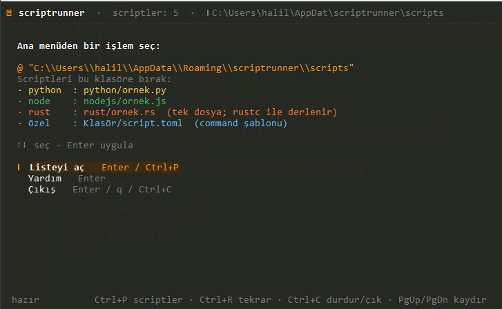
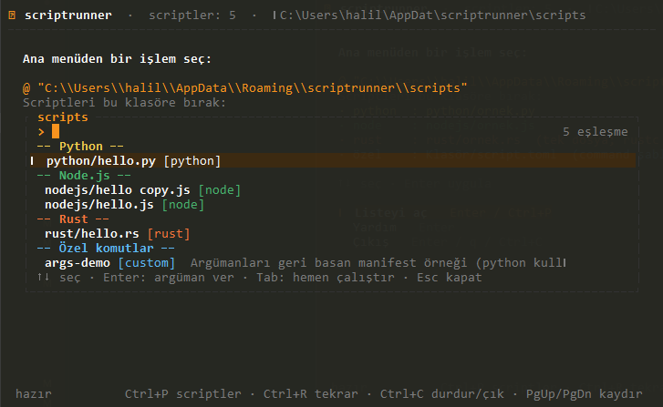
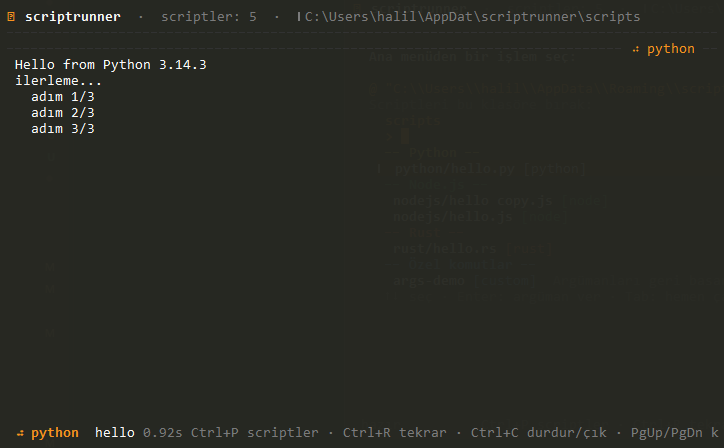

# sr (scriptrunner)

[English](README.md) | [Türkçe](README.tr.md)

A lightweight Rust script runner with a terminal UI. Press **Ctrl+P** to find a
script, enter arguments, and run it. No AI or background service required.

## Screenshots

### Main screen


### Script list


### Running a script


## Features

- Discovers scripts in the app's scripts directory and its subdirectories.
- Supports Python (`.py`, `.pyw`), Node.js (`.js`, `.mjs`, `.cjs`), standalone
  Rust (`.rs`), and custom commands defined with `script.toml`.
- Filters scripts as you type, passes arguments, and displays stdout/stderr.
- Provides both an interactive TUI and non-interactive CLI commands.
- Detects Turkish or English from the system locale. Override it with
  `SR_LANG=tr` or `SR_LANG=en`.

PowerShell override example: `$env:SR_LANG = "tr"`.

## Data directories

| OS | Scripts and config | Rust build cache |
|---|---|---|
| Windows | `%APPDATA%\scriptrunner\` | `%LOCALAPPDATA%\scriptrunner\cache\` |
| Linux | `~/.local/share/scriptrunner/` | `~/.cache/scriptrunner/cache/` |
| macOS | `~/Library/Application Support/scriptrunner/` | `~/Library/Caches/scriptrunner/cache/` |

Set `SCRIPTRUNNER_CONFIG` to use a different config/scripts root. Run `sr --dir`
to print the active scripts directory.

## Adding scripts

Put scripts in the directory printed by `sr --dir`; subdirectories are scanned
too. For example, `python/hello.py` can be run as `sr run python/hello.py`.

- `.py` / `.pyw` → Python (`python` on Windows, `python` or `python3` elsewhere)
- `.js` / `.mjs` / `.cjs` → Node.js
- `.rs` → compiled with `rustc` and cached; standalone files only
- A folder containing `script.toml` → custom command

Example `script.toml`:

```toml
name = "deploy"
description = "Deploy the application"
command = 'pwsh -NoProfile -File {{dir}}\deploy.ps1 {{args}}'
default_args = "--target prod"
# cwd = ".." # optional; relative to the script directory
```

`{{dir}}` expands to the script directory and `{{args}}` to the supplied
arguments. If `{{args}}` is omitted, arguments are appended to the command.
Use a command such as `cargo run` in a manifest for Rust projects with external
crate dependencies.

## Keyboard shortcuts

| Key | Action |
|---|---|
| `Up` / `Down` or `j` / `k` | Navigate menus and lists |
| `Enter` | Confirm or enter script arguments |
| `Ctrl+P` | Open/close the script palette |
| `Tab` | Run the selected script with its defaults |
| `Ctrl+U` / `Ctrl+W` | Clear input / delete previous word |
| `Ctrl+R` | Rerun the last job |
| `Ctrl+C` | Stop a job, or quit when idle |
| `Esc` | Close the palette or return from argument entry |
| `Backspace` | Return from a completed job to the main screen |
| `PgUp` / `PgDn`, `Home` / `End` | Scroll output |
| `q` | Quit from the main screen |

## CLI

```text
sr                         Open the TUI
sr --help                  Show commands and help
sr --list                  List discovered scripts
sr --dir                   Print the scripts directory
sr --open                  Open the scripts directory (Windows)
sr run python/hello.py a b Run a script without the TUI
```

## Download and install

Release binaries are built for Windows x64, Linux x64/ARM64, and macOS
Intel/Apple Silicon. Download the matching asset from
[GitHub Releases](https://github.com/halil07/scriptrunner/releases/latest):

- Windows: `sr-windows-x86_64.exe`
- Linux x64: `sr-linux-x86_64`
- Linux ARM64: `sr-linux-aarch64`
- macOS Intel: `sr-macos-x86_64`
- macOS Apple Silicon: `sr-macos-aarch64`

Linux x64 example:

```sh
curl -L https://github.com/halil07/scriptrunner/releases/latest/download/sr-linux-x86_64 -o sr
chmod +x sr
./sr --help
sudo install -m 755 sr /usr/local/bin/sr
```

On macOS, download the binary matching your CPU architecture, then `chmod +x`
it before running. On Windows, download the `.exe` and add its containing
directory to `PATH` if you want to invoke `sr` from any terminal.

The `sr` executable does not require Rust. Install Python, Node.js, or `rustc`
separately for the script types you intend to run, or specify custom interpreter
paths in `config.toml` under `[interpreters]`. The first TUI launch offers to
create a sample config and checks for interpreters.

## Build from source

Install the stable Rust toolchain, then run:

```sh
cargo test --locked
cargo build --release --locked
```

The executable is `target/release/sr` (`sr.exe` on Windows). The GitHub Actions
release workflow builds the supported OS/architecture binaries when a `v*` tag
is pushed.
